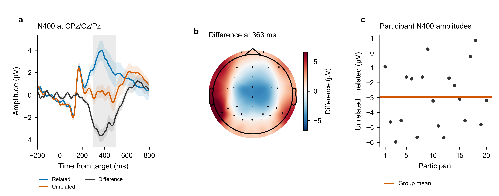
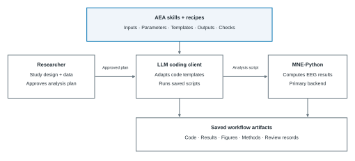

<div align="center">

# AEA：EEG解析のための共有可能なスキルとレシピ

<p align="center"><a href="README.md">English</a> · <a href="README.zh-CN.md">简体中文</a> · <strong>日本語</strong></p>

[](docs/GETTING_STARTED.md)
[](LICENSE)
[](docs/EEGLAB.md)

**[日本語ホームページ](https://dengzhe-hou.github.io/auto-eeg-analysis/index.ja.html) · [利用ガイド](docs/GETTING_STARTED.md) · [レシピ一覧](recipes/README.md) · [検証範囲](docs/CERTIFICATION_LEVELS.md) · [貢献方法](CONTRIBUTING.md) · [リリース](https://github.com/dengzhe-hou/auto-eeg-analysis/releases/latest)**

</div>

AEA（Automated EEG Analysis）は、MNE-Python向けの **22のスキルと10のレシピ**を提供する公開ライブラリです。実行可能な仕様と、数値認証の対象となる中核（numerically certified core）を備えています。スキルにはEEG解析手法、数値計算の規約、コードテンプレート、出力の確認項目をまとめ、レシピでは実験パラダイムに合わせてスキルを組み合わせます。

研究者が研究内容を定め、解析計画を承認します。コーディング支援エージェントが利用者の環境でテンプレートを調整・実行し、計画、コード、結果、図、方法の記述、レビュー記録をまとめて保存します。

| 段階 | 担当とリソース | 入力 → 出力 |
| --- | --- | --- |
| **内容を定めて承認** | 研究者、レシピ、スキル | 研究課題とデータ → 承認済み解析計画 |
| **調整して実行** | コーディング支援エージェントとテンプレート | 承認済み計画 → 主にMNE-Pythonで実行するスクリプト |
| **確認して再実行** | 研究者と出力確認 | 保存済み結果 → 図、方法の記述、レビュー、記録に沿った再実行 |

## 出力例

[](docs/assets/n400-example.png)

固定N400例では、ERP COREの20名について、CPz/Cz/PzのERP波形と参加者間の±1 SEM、記述的な差分頭皮分布図、および300–500 msにおける各参加者の「非関連条件−関連条件」の振幅を保存しています。[保存された設定と結果](tools/examples/n400/recipe_case_results.json)は、記録されたエージェント実行や過去の認証とは別に扱います。

[例を実行](docs/EXAMPLES.md#erp-core-complete-n400-recipe-case) · [保存済み結果から図を再作成](docs/EXAMPLES.md#replot-the-saved-results) · [エージェントの実行記録を確認](docs/EXAMPLES.md#adapt-a-recipe-to-your-study)

---

## クイックスタート

このREADMEとホームページは3言語に対応しています。詳細ガイド、スキル・レシピのソース、図中の文字、EEGLABのメニュー、固定レポートのテンプレートは、現在も主に英語です。コーディング支援エージェントとのやり取りには日本語を使えます。

**EEGLAB拡張が承認されました：** AEA 0.1.3は[EEGLAB公式拡張一覧](https://sccn.ucsd.edu/eeglab/plugin_uploader/plugin_list_all.php)に掲載されています。EEGLABの **File > Manage EEGLAB extensions** で **AEA** を検索してインストールし、[設定ガイド](docs/EEGLAB.md)に従ってAEAのソースフォルダとコーディングクライアントを接続してください。

既存の解析環境では、[PyPIプレビュー版](https://pypi.org/project/auto-eeg-analysis/0.3.3rc2/)からAEAプロジェクトを作成できます。

```sh
python -m pip install auto-eeg-analysis==0.3.3rc2
aea-eeg init ./my-eeg-study --agent codex
cd my-eeg-study
```

Claude Codeには `--agent claude`、両方には `--agent both` を指定します。作成したプロジェクトから、既存のMNE環境でクライアントを起動してください。既定のパッケージは科学計算用の依存関係を自動インストールしません。[パッケージ導入ガイド](docs/PACKAGES.md)に環境設定を記載しています。

[MATLABツールボックスのプレビュー版](https://github.com/dengzhe-hou/auto-eeg-analysis/releases/download/eeglab-v0.1.3-preview/AEA_MATLAB_EEGLAB_0_1_3_preview.mltbx)にはリソースとEEGLABアダプターが含まれます。[File Exchange](https://www.mathworks.com/matlabcentral/fileexchange/185187-aea-for-matlab-and-eeglab)ではGitHubのソースを提供しています。インストールには上記の `.mltbx` リンクを使い、[設定ガイド](extensions/matlab/README.md)に従ってください。

Gitのソースと新しいConda環境を使う場合は、Git、Conda、およびログイン済みのCodex CLIまたはClaude Codeを用意してください。以下は `main` を使う手順で、[v0.3.2](CHANGELOG.md#choose-a-version)以降の修正を含みます。

```bash
git clone https://github.com/dengzhe-hou/auto-eeg-analysis.git
cd auto-eeg-analysis
conda env create -f environment.yml
conda activate aeais
python tools/install_skills.py --agent codex
codex
```

`aeais` を有効にした状態で、リポジトリのルートから起動します。対応するデータを `projects/my-study/raw/` に置いた場合は、**Codex内**で次を入力します。

```text
$eeg-recipe n400-semantic --data projects/my-study
```

実験パラダイムに合うレシピを選んでください。ERP COREでは、既存のデータ配置を保つため、[コピーして使えるN400のデータ説明と承認プロンプト](docs/EXAMPLES.md#adapt-a-recipe-to-your-study)に従ってください。Claude Codeでは、`--agent claude` でスキルを導入し、`claude` を起動して、`$eeg-recipe` の代わりに `/eeg-recipe` を使います。

実行前に解析計画を確認し、監査段階に備えて[レビュー用モデルを設定](docs/GETTING_STARTED.md#configure-the-reviewer)してください。[セットアップガイド](docs/GETTING_STARTED.md)では、データ形式、研究用ディレクトリ、Windowsの設定、出力ファイルを説明しています。

WindowsとEEGLABを使う場合は、[最初のレポートを作る手順](docs/WINDOWS_FIRST_RUN.md)を参照してください。クライアントの導入、Pythonと実行ファイルのパス、メニュー設定、レポートの開き方を説明しています。[プレビュー拡張](docs/EEGLAB.md)がEEGLABとAEAを接続し、解析には主にPython/MNEを使います。

**[EEGLAB 0.1.3プレビュー](https://github.com/dengzhe-hou/auto-eeg-analysis/releases/tag/eeglab-v0.1.3-preview)**では、Python/MNEを必要としない[MATLABネイティブ経路](docs/MATLAB_NATIVE.md)を追加しました。研究用フォルダの準備、クライアント起動、範囲を限定したERP平均値の計算、図とレポートの作成に対応します。同じプレビューのソースとプラグインZIPを組み合わせてください。旧0.1.2パッケージにはこの経路は含まれません。

> [!TIP]
> エージェントやモデルのアカウントなしでN400の例を試すには、[固定Pythonチュートリアル](docs/EXAMPLES.md#erp-core-complete-n400-recipe-case)を使えます。[生のEEGを読み込まずに保存済み結果から図を再作成](docs/EXAMPLES.md#replot-the-saved-results)することもできます。

---

## 使い方の流れ

[](docs/assets/library-overview.svg)

[記録されたエージェントのワークフロー](docs/EXAMPLES.md#adapt-a-recipe-to-your-study) · [独自の解析を設計](docs/GETTING_STARTED.md#w2-design-a-custom-analysis) · [再実行ガイド](docs/REPLAY.md)

---

## ライブラリを見る

| リソース | 内容 | 入口 |
| --- | --- | --- |
| スキル | 前処理、ERP、スペクトル、時間周波数解析、結合性、統計、作図、レポート | [タスク別ガイド](docs/GETTING_STARTED.md#choose-skills-for-a-task) · [スキルファイル](skills/) |
| レシピ | パラダイム別の手順、データ要件、パラメータ選択、出典論文 | [レシピ一覧](recipes/README.md) |
| 実行例 | 計画、スクリプト、保存済み結果、図、再実行の手順 | [実行例ガイド](docs/EXAMPLES.md) |

---

## 検証範囲

認証の対象は、[検証範囲の記録](docs/CERTIFICATION_LEVELS.md)に明記された**出力と設定**です。数値計算の中核には、選択されたERP振幅、クラスタ統計量、周波数帯域パワーを含みます。EEGLABとFieldTripは、独立した比較と、一部の代替バックエンド経路を提供します。

各[レシピ](recipes/README.md#available-recipes)には、申告されている状態と利用可能な評価を記録しています。数値計算の中核を確認していても、すべての設定や生成されたワークフローが認証されたことにはなりません。

[検証範囲](docs/CERTIFICATION_LEVELS.md) · [ベンチマークの設定と結果](https://github.com/dengzhe-hou/auto-eeg-analysis/blob/995f53d42cc74205b164e8711d4b289b8c2ad3a1/docs/BENCHMARK.md)

---

## 引用と貢献

AEAの引用には [CITATION.cff](CITATION.cff) を使い、実際に使用したバージョンまたはコミットを記録してください。レシピの出典論文も引用してください。[Zenodoアーカイブ](https://doi.org/10.5281/zenodo.24012489)は2026年11月6日時点で固定したリソースと検証記録を保存しています。パッケージとアーカイブの対応は[公開バージョンの説明](docs/PACKAGES.md#public-versions-and-archives)、貢献方法は[貢献ガイド](CONTRIBUTING.md)を参照してください。

公式の利用チュートリアルは英語で提供します。[任意の言語でコミュニティのチュートリアルを投稿](CONTRIBUTING.md#share-a-community-tutorial)したり、途中で止まった試行や失敗を含めて[初回利用や環境ごとの動作結果を報告](CONTRIBUTING.md#report-a-first-run-or-platform-check)したりすることも歓迎します。

[変更履歴](CHANGELOG.md) · [トラブルシューティング](docs/GETTING_STARTED.md#troubleshooting) · [Issue](https://github.com/dengzhe-hou/auto-eeg-analysis/issues)

ソフトウェアは [MITライセンス](LICENSE)、レシピのメタデータはCC BY 4.0で公開しています。[ARIS](https://github.com/wanshuiyin/Auto-claude-code-research-in-sleep)を基に構築しています。

レイアウトの参考：[CRAFT](https://looketal.com/s/readme-coral-lab-asu-craft.html)、[Look et al.](https://looketal.com/)より。
