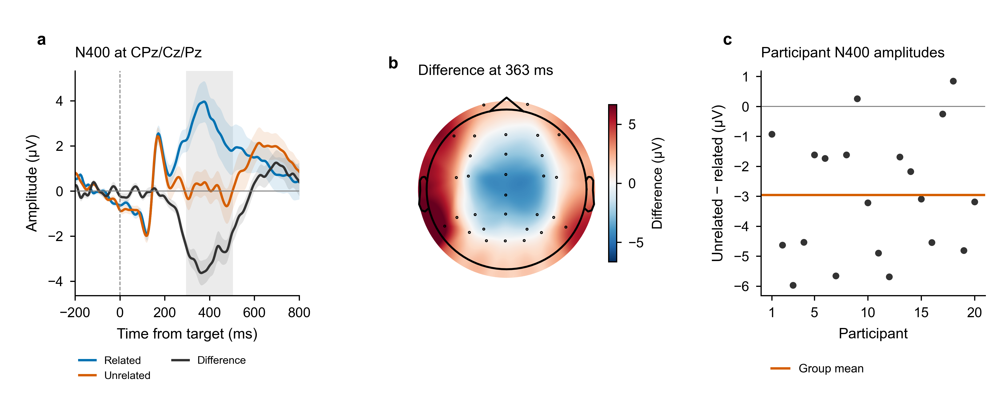

<div align="center">

# Auto EEG Analysis

**Reusable EEG analysis skills for coding agents.**

**English** · [简体中文](README.zh-CN.md) · [日本語](README.ja.md)

[Website](https://dengzhe-hou.github.io/Auto-EEG-Analysis/) · [Documentation](docs/GETTING_STARTED.md) · [PyPI preview](https://pypi.org/project/auto-eeg-analysis/0.3.3rc2/) · [EEGLAB 0.1.3](docs/EEGLAB.md) · [Zenodo](https://doi.org/10.5281/zenodo.24012489)

</div>

AEA provides **22 analysis skills and 10 study recipes** for coding agents. You approve the scientific plan. The agent reads the procedures and runs code in your environment, retaining scripts, results, figures and review records.

[Quickstart](#quickstart) · [Explore the library](#library) · [Validation](#validation) · [Contribute](#contributing)

[](docs/EXAMPLES.md#erp-core-complete-n400-recipe-case)

A fixed tutorial on 20 ERP CORE participants. CPz/Cz/Pz ERPs show ±1 participant SEM. The amplitude window is 300–500 ms. The tutorial omits ICA and is separate from the recorded agent run.

[Replot saved results](docs/EXAMPLES.md#replot-the-saved-results) · [Run the tutorial](docs/EXAMPLES.md#erp-core-complete-n400-recipe-case) · [Recorded agent case](docs/EXAMPLES.md#adapt-a-recipe-to-your-study)

<a id="quickstart"></a>
## Quickstart

The PyPI preview creates a new project with the AEA resources. Python 3.10+ and an existing MNE environment are required. The default package does not install the scientific dependencies.

```sh
python -m pip install auto-eeg-analysis==0.3.3rc2
aea-eeg init ./my-eeg-study --agent codex
cd my-eeg-study
codex
```

Place compatible data in my-eeg-study/raw/, then start your signed-in coding client in that project. Choose the recipe for your paradigm and approve the plan before computation.

```text
$eeg-recipe n400-semantic --data .
```

Claude Code → `--agent claude`, `claude`, `/eeg-recipe n400-semantic --data .`

[Full setup and dependencies](docs/GETTING_STARTED.md) · [Configure the reviewer for the audit stage.](docs/GETTING_STARTED.md#configure-the-reviewer)

### Choose your entry point

| | |
| --- | --- |
| **Python / MNE** | Create a project with the PyPI preview, or use a Git checkout. [Documentation](docs/PACKAGES.md) |
| **MATLAB / EEGLAB** | Install the EEGLAB extension or MATLAB toolbox preview. [Documentation](docs/EEGLAB.md) |
| **No model account** | Replot saved arrays, or run the fixed N400 tutorial. [Documentation](docs/EXAMPLES.md#replot-the-saved-results) |

Install AEA 0.1.3 through the EEGLAB extension manager, or use the MATLAB toolbox preview. The native MATLAB route covers explicit ERP means from existing epochs. The broader library primarily uses MNE-Python.

[Windows first report](docs/WINDOWS_FIRST_RUN.md) · [Native MATLAB scope](docs/MATLAB_NATIVE.md) · [FieldTrip](https://www.fieldtriptoolbox.org/extensions/) · [File Exchange](https://www.mathworks.com/matlabcentral/fileexchange/185187-aea-for-matlab-and-eeglab)

<a id="library"></a>
## Explore the library

### 10 Recipes

| Recipes | Analysis | Status |
| --- | --- | --- |
| [ern-flankers](recipes/ern-flankers/RECIPE.md) | N2, response-related negativity, frontal theta | Validated |
| [mmn-oddball](recipes/mmn-oddball/RECIPE.md) | Auditory mismatch negativity | Validated |
| [p300-oddball](recipes/p300-oddball/RECIPE.md) | P300 to rare targets | Experimental. Group validation recorded. |
| [n170-faces](recipes/n170-faces/RECIPE.md) | Faces versus non-face controls | Validated |
| [n170-face-inversion](recipes/n170-face-inversion/RECIPE.md) | Upright versus inverted faces | Experimental |
| [n400-semantic](recipes/n400-semantic/RECIPE.md) | Semantic priming | Validated |
| [alpha-attention-cueing](recipes/alpha-attention-cueing/RECIPE.md) | Posterior alpha modulation | Experimental |
| [resting-microstate](recipes/resting-microstate/RECIPE.md) | Resting microstate maps and dynamics | Validated |
| [resting-spectral-connectivity](recipes/resting-spectral-connectivity/RECIPE.md) | Power spectra, aperiodic fits, connectivity | Validated |
| [complexity-anesthesia](recipes/complexity-anesthesia/RECIPE.md) | Continuous complexity and entropy | Validated. Awake-state check only. Anesthesia untested. |

Recipe status and validation apply to the configurations recorded in each source. [Recipe catalogue](recipes/README.md)

### 22 Skills

| | |
| --- | --- |
| Data and preparation | [eeg-bids](skills/eeg-bids/SKILL.md) · [eeg-qc](skills/eeg-qc/SKILL.md) · [eeg-preprocess](skills/eeg-preprocess/SKILL.md) · [eeg-ica](skills/eeg-ica/SKILL.md) · [eeg-epoch](skills/eeg-epoch/SKILL.md) |
| ERP and time-frequency | [eeg-erp](skills/eeg-erp/SKILL.md) · [eeg-tfr](skills/eeg-tfr/SKILL.md) |
| Continuous signals | [eeg-spectral](skills/eeg-spectral/SKILL.md) · [eeg-connectivity](skills/eeg-connectivity/SKILL.md) · [eeg-microstate](skills/eeg-microstate/SKILL.md) · [eeg-complexity](skills/eeg-complexity/SKILL.md) · [eeg-source](skills/eeg-source/SKILL.md) |
| Statistics and behavior | [eeg-stats](skills/eeg-stats/SKILL.md) · [eeg-group-compare](skills/eeg-group-compare/SKILL.md) · [eeg-decoding](skills/eeg-decoding/SKILL.md) · [eeg-behavior](skills/eeg-behavior/SKILL.md) |
| Outputs and review | [eeg-figure](skills/eeg-figure/SKILL.md) · [eeg-methods-text](skills/eeg-methods-text/SKILL.md) · [eeg-report](skills/eeg-report/SKILL.md) · [eeg-audit](skills/eeg-audit/SKILL.md) |
| Workflow orchestration | [eeg-pipeline](skills/eeg-pipeline/SKILL.md) · [eeg-recipe](skills/eeg-recipe/SKILL.md) |

<a id="validation"></a>
## Validation

MNE-Python is the primary backend. EEGLAB and FieldTrip supply independent comparisons and selected alternative routes. Certification applies to the outputs and configurations in the coverage record.

[Validation coverage](docs/CERTIFICATION_LEVELS.md) · [Benchmark](https://github.com/dengzhe-hou/Auto-EEG-Analysis/blob/995f53d42cc74205b164e8711d4b289b8c2ad3a1/docs/BENCHMARK.md) · [Research archive](https://doi.org/10.5281/zenodo.24012489) · [Replay instructions](docs/REPLAY.md)

<a id="contributing"></a>
## Contribute

Contribute a recipe, improve a skill, share a tutorial, or report a first run. See the contribution guide for validation requirements and recognition.

[Contribution guide](CONTRIBUTING.md) · [Report a first run](https://github.com/dengzhe-hou/Auto-EEG-Analysis/issues/new?template=first-run-platform-feedback.md) · [Questions and bugs](https://github.com/dengzhe-hou/Auto-EEG-Analysis/issues)

## Cite the version you use

Cite AEA with the software version or commit, and cite the original methods and datasets. The Zenodo record is the frozen 6 November 2026 resource and validation archive.

[Software citation](CITATION.cff) · [Packages and versions](docs/PACKAGES.md#public-versions-and-archives)

Detailed usage guides are maintained in English. Community tutorials in other languages are welcome.

[MIT](LICENSE) · Recipe metadata CC BY 4.0 · Built on [ARIS](https://github.com/wanshuiyin/Auto-claude-code-research-in-sleep)
