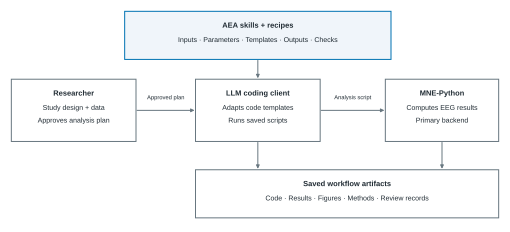
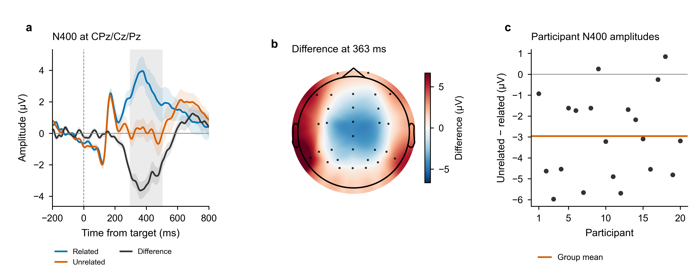

<h1 align="center">AEA</h1>
<h3 align="center">可共享的 EEG 分析技能与工作流配方</h3>

<p align="center"><a href="README.md">English</a> · <strong>简体中文</strong> · <a href="README.ja.md">日本語</a></p>

AEA（Automated EEG Analysis，自动化脑电分析）是一个开放资源库，提供面向 MNE-Python 的 **22 个技能（skills）和 10 个工作流配方（recipes）**，包含可执行规范和经过数值认证的核心。技能整合 EEG 方法、数值约定、代码模板和输出检查；配方将技能组合为适用于特定实验范式的工作流。

研究者定义研究问题并批准分析方案。编程助手在你的环境中调整并执行模板，将方案、代码、结果、图、方法文字和审阅记录保存在一起。

[中文主页](https://dengzhe-hou.github.io/auto-eeg-analysis/index.zh-CN.html) · [使用指南](docs/GETTING_STARTED.md) · [配方目录](recipes/README.md) · [验证范围](docs/CERTIFICATION_LEVELS.md) · [参与贡献](CONTRIBUTING.md) · [发布版本](https://github.com/dengzhe-hou/auto-eeg-analysis/releases/latest)

此 README 和主页提供三语版本。详细指南、技能与配方源文件、图中文字、EEGLAB 菜单及固定报告模板目前仍以英文为主。可以用中文与编程助手沟通。

**EEGLAB 扩展已获批准：** AEA 0.1.3 已列入 [EEGLAB 官方扩展目录](https://sccn.ucsd.edu/eeglab/plugin_uploader/plugin_list_all.php)。在 EEGLAB 中打开 **File > Manage EEGLAB extensions**，搜索 **AEA** 并安装，再按[配置指南](docs/EEGLAB.md)连接 AEA 源码目录和编程客户端。

## 快速开始

先安装 Git、Conda，以及已登录的 Codex CLI 或 Claude Code。以下命令使用 `main`，包含 [v0.3.2](CHANGELOG.md#choose-a-version) 之后的修正。

```bash
git clone https://github.com/dengzhe-hou/auto-eeg-analysis.git
cd auto-eeg-analysis
conda env create -f environment.yml
conda activate aeais
python tools/install_skills.py --agent codex
codex
```

在仓库根目录运行，并保持 `aeais` 环境已激活。若兼容的数据位于 `projects/my-study/raw/`，在 **Codex 内**输入：

```text
$eeg-recipe n400-semantic --data projects/my-study
```

选择符合实验范式的配方。使用 ERP CORE 时，请参照[可直接复制的 N400 数据说明与批准提示](docs/EXAMPLES.md#adapt-a-recipe-to-your-study)，保留现有数据布局。使用 Claude Code 时，以 `--agent claude` 安装技能，启动 `claude`，并将 `$eeg-recipe` 改为 `/eeg-recipe`。

执行前确认分析方案，并为审阅阶段[配置审阅模型](docs/GETTING_STARTED.md#configure-the-reviewer)。[安装指南](docs/GETTING_STARTED.md)说明了数据格式、研究目录、Windows 配置和输出文件。

使用 Windows 和 EEGLAB？[首次报告教程](docs/WINDOWS_FIRST_RUN.md)涵盖客户端安装、Python 与可执行文件路径、菜单设置和报告打开方式。[预览扩展](docs/EEGLAB.md)连接 EEGLAB 与 AEA，分析主要使用 Python/MNE。

**[EEGLAB 0.1.3 预览版](https://github.com/dengzhe-hou/auto-eeg-analysis/releases/tag/eeglab-v0.1.3-preview)** 新增 [MATLAB 原生路线](docs/MATLAB_NATIVE.md)，无需 Python/MNE 即可准备研究、启动客户端，并在限定范围内完成 ERP 均值计算、图和报告。请搭配该版本的源码和插件 ZIP 使用；较早的 0.1.2 安装包不包含这条路线。

> [!TIP]
> 不使用编程助手或模型账户，也可以运行[固定 Python 教程](docs/EXAMPLES.md#erp-core-complete-n400-recipe-case)体验 N400 示例；还可以[不读取原始 EEG，直接用已保存结果重新作图](docs/EXAMPLES.md#replot-the-saved-results)。

## 如何工作

| 步骤 | 实际操作 |
| --- | --- |
| 明确问题并批准方案 | 定义研究问题和分析选择，选择配方或组合技能。 |
| 调整并执行 | 助手读取流程，调整代码模板，主要通过 MNE-Python 执行。 |
| 检查并重放 | 审阅保存的输出、图、方法文字和检查记录，重放已记录的分析。 |

[](docs/assets/library-overview.svg)

[已记录的助手工作流](docs/EXAMPLES.md#adapt-a-recipe-to-your-study) · [自定义分析](docs/GETTING_STARTED.md#w2-design-a-custom-analysis) · [重放指南](docs/REPLAY.md)

## 输出示例

[](docs/assets/n400-example.png)

固定 N400 示例保留了 20 名 ERP CORE 参与者的结果：CPz/Cz/Pz 的 ERP 曲线及参与者间 ±1 SEM、描述性差值头皮图，以及每位参与者在 300–500 ms 的“不相关减相关”幅值。其[保存的配置和结果](tools/examples/n400/recipe_case_results.json)与已记录的助手运行和历史认证分别记录。

[运行示例](docs/EXAMPLES.md#erp-core-complete-n400-recipe-case) · [用保存的结果重新作图](docs/EXAMPLES.md#replot-the-saved-results) · [查看助手案例记录](docs/EXAMPLES.md#adapt-a-recipe-to-your-study)

## 浏览资源库

| 资源 | 内容 | 从这里开始 |
| --- | --- | --- |
| 技能 | 预处理、ERP、频谱、时频分析、连接性、统计、绘图和报告 | [任务索引](docs/GETTING_STARTED.md#choose-skills-for-a-task) · [技能文件](skills/) |
| 配方 | 特定范式的工作流、数据要求、参数选择和来源论文 | [配方目录](recipes/README.md) |
| 完整示例 | 方案、脚本、保存的结果、图和重放说明 | [示例指南](docs/EXAMPLES.md) |

## 验证范围

认证仅适用于[覆盖记录](docs/CERTIFICATION_LEVELS.md)中列出的**输出和配置**。数值核心涵盖部分 ERP 幅值、cluster 统计和频带功率。EEGLAB 与 FieldTrip 提供独立比较以及部分替代后端路线。

每个[配方](recipes/README.md#available-recipes)均记录其声明状态和已有评估。经过检查的数值核心不等于所有选项或生成的工作流都已认证。

[验证范围](docs/CERTIFICATION_LEVELS.md) · [基准配置与结果](https://github.com/dengzhe-hou/auto-eeg-analysis/blob/995f53d42cc74205b164e8711d4b289b8c2ad3a1/docs/BENCHMARK.md)

## 引用与贡献

引用 AEA 时请使用 [CITATION.cff](CITATION.cff)，并引用所用配方声明的来源论文。新增或改进技能、配方，请参照[贡献指南](CONTRIBUTING.md)。

官方使用教程提供英文版。社区可以[贡献任意语言的教程](CONTRIBUTING.md#share-a-community-tutorial)，也可以[提交首次使用和平台测试反馈](CONTRIBUTING.md#report-a-first-run-or-platform-check)，包括未完成或失败的尝试。

[更新记录](CHANGELOG.md) · [问题排查](docs/GETTING_STARTED.md#troubleshooting) · [提交问题](https://github.com/dengzhe-hou/auto-eeg-analysis/issues)

软件采用 [MIT 许可证](LICENSE)，配方元数据采用 CC BY 4.0。项目基于 [ARIS](https://github.com/wanshuiyin/Auto-claude-code-research-in-sleep) 构建。

版式参考：[PEFT](https://looketal.com/s/readme-huggingface-peft.html)，来自 [Look et al.](https://looketal.com/)。
