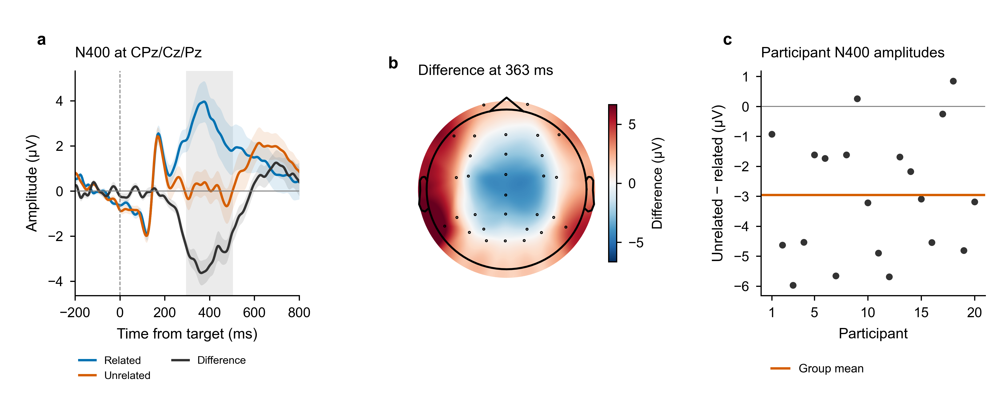

<div align="center">

# Auto EEG Analysis

**让编程助手复用 EEG 分析流程。**

[English](README.md) · **简体中文** · [日本語](README.ja.md)

[Website](https://dengzhe-hou.github.io/Auto-EEG-Analysis/index.zh-CN.html) · [使用文档](docs/GETTING_STARTED.md) · [PyPI package](https://pypi.org/project/auto-eeg-analysis/0.3.3/) · [EEGLAB 0.1.3](docs/EEGLAB.md) · [Zenodo](https://doi.org/10.5281/zenodo.24012489)

</div>

AEA 提供面向编程助手的 **22 个分析技能和 10 个工作流配方**。研究者批准科学方案，助手读取流程并在本机环境执行代码，保留脚本、结果、图与审阅记录。

[快速开始](#quickstart) · [浏览资源库](#library) · [验证范围](#validation) · [参与贡献](#contributing)

[](docs/EXAMPLES.md#erp-core-complete-n400-recipe-case)

20 名 ERP CORE 参与者的固定教程。CPz/Cz/Pz ERP 的阴影为参与者间 ±1 SEM，幅值时间窗为 300–500 ms。教程不使用 ICA，与助手执行案例分别记录。

[用保存的结果作图](docs/EXAMPLES.md#replot-the-saved-results) · [运行完整教程](docs/EXAMPLES.md#erp-core-complete-n400-recipe-case) · [助手执行案例](docs/EXAMPLES.md#adapt-a-recipe-to-your-study)

<a id="quickstart"></a>
## 快速开始

PyPI 软件包会创建包含 AEA 资源的新工程，需要 Python 3.10+ 和已有的 MNE 环境。默认安装包不包含科学计算依赖。

```sh
python -m pip install auto-eeg-analysis==0.3.3
aea-eeg init ./my-eeg-study --agent codex
cd my-eeg-study
codex
```

把兼容数据放入 my-eeg-study/raw/，在该工程内启动已登录的编程客户端。选择适合范式的配方，计算前确认分析方案。

```text
$eeg-recipe n400-semantic --data .
```

Claude Code → `--agent claude`, `claude`, `/eeg-recipe n400-semantic --data .`

[完整安装与依赖说明](docs/GETTING_STARTED.md) · [为审阅阶段配置审阅模型。](docs/GETTING_STARTED.md#configure-the-reviewer)

### 选择入口

| | |
| --- | --- |
| **Python / MNE** | 用 PyPI 软件包创建工程，也可使用 Git 源码。 [使用文档](docs/PACKAGES.md) |
| **MATLAB / EEGLAB** | 安装 EEGLAB 扩展或 MATLAB 工具箱预览包。 [使用文档](docs/EEGLAB.md) |
| **不使用模型账户** | 用保存的数组重新作图，或运行固定 N400 教程。 [使用文档](docs/EXAMPLES.md#replot-the-saved-results) |

通过 EEGLAB 扩展管理器安装 AEA 0.1.3，或使用 MATLAB 工具箱预览包。原生 MATLAB 路线支持从已有 epochs 计算明确指定的 ERP 均值。更广泛的资源库主要使用 MNE-Python。

[Windows 首次报告指南](docs/WINDOWS_FIRST_RUN.md) · [MATLAB 原生路线范围](docs/MATLAB_NATIVE.md) · [FieldTrip](https://www.fieldtriptoolbox.org/extensions/) · [File Exchange](https://www.mathworks.com/matlabcentral/fileexchange/185187-aea-for-matlab-and-eeglab)

<a id="library"></a>
## 浏览资源库

### 10 配方

| 配方 | 分析 | Status |
| --- | --- | --- |
| [ern-flankers](recipes/ern-flankers/RECIPE.md) | N2、反应相关负波、额叶 theta | 已验证 |
| [mmn-oddball](recipes/mmn-oddball/RECIPE.md) | 听觉失匹配负波 | 已验证 |
| [p300-oddball](recipes/p300-oddball/RECIPE.md) | 稀有目标诱发的 P300 | 实验性 已记录组水平验证结果 |
| [n170-faces](recipes/n170-faces/RECIPE.md) | 人脸与非人脸对照 | 已验证 |
| [n170-face-inversion](recipes/n170-face-inversion/RECIPE.md) | 正立与倒立人脸 | 实验性 |
| [n400-semantic](recipes/n400-semantic/RECIPE.md) | 语义启动 | 已验证 |
| [alpha-attention-cueing](recipes/alpha-attention-cueing/RECIPE.md) | 后部 alpha 调制 | 实验性 |
| [resting-microstate](recipes/resting-microstate/RECIPE.md) | 静息态微状态图与动态 | 已验证 |
| [resting-spectral-connectivity](recipes/resting-spectral-connectivity/RECIPE.md) | 功率谱、非周期成分拟合、连接性 | 已验证 |
| [complexity-anesthesia](recipes/complexity-anesthesia/RECIPE.md) | 连续信号的复杂度与熵 | 已验证 已检查清醒状态；此处尚未测试麻醉状态 |

配方状态与验证适用于各源码文件记录的具体配置。 [配方完整目录](recipes/README.md)

### 22 技能

| | |
| --- | --- |
| 数据与准备 | [eeg-bids](skills/eeg-bids/SKILL.md) · [eeg-qc](skills/eeg-qc/SKILL.md) · [eeg-preprocess](skills/eeg-preprocess/SKILL.md) · [eeg-ica](skills/eeg-ica/SKILL.md) · [eeg-epoch](skills/eeg-epoch/SKILL.md) |
| ERP 与时频 | [eeg-erp](skills/eeg-erp/SKILL.md) · [eeg-tfr](skills/eeg-tfr/SKILL.md) |
| 连续信号 | [eeg-spectral](skills/eeg-spectral/SKILL.md) · [eeg-connectivity](skills/eeg-connectivity/SKILL.md) · [eeg-microstate](skills/eeg-microstate/SKILL.md) · [eeg-complexity](skills/eeg-complexity/SKILL.md) · [eeg-source](skills/eeg-source/SKILL.md) |
| 统计与行为 | [eeg-stats](skills/eeg-stats/SKILL.md) · [eeg-group-compare](skills/eeg-group-compare/SKILL.md) · [eeg-decoding](skills/eeg-decoding/SKILL.md) · [eeg-behavior](skills/eeg-behavior/SKILL.md) |
| 输出与审阅 | [eeg-figure](skills/eeg-figure/SKILL.md) · [eeg-methods-text](skills/eeg-methods-text/SKILL.md) · [eeg-report](skills/eeg-report/SKILL.md) · [eeg-audit](skills/eeg-audit/SKILL.md) |
| 流程编排 | [eeg-pipeline](skills/eeg-pipeline/SKILL.md) · [eeg-recipe](skills/eeg-recipe/SKILL.md) |

<a id="validation"></a>
## 验证范围

MNE-Python 是主要后端。EEGLAB 和 FieldTrip 提供独立比较与部分替代路线。认证适用于覆盖记录中的输出和配置。

[验证范围](docs/CERTIFICATION_LEVELS.md) · [Benchmark](https://github.com/dengzhe-hou/Auto-EEG-Analysis/blob/995f53d42cc74205b164e8711d4b289b8c2ad3a1/docs/BENCHMARK.md) · [研究材料归档](https://doi.org/10.5281/zenodo.24012489) · [重放说明](docs/REPLAY.md)

<a id="contributing"></a>
## 参与贡献

可以添加配方、改进技能、分享教程，或报告首次运行情况。验证要求和贡献认可见贡献指南。

[贡献指南](CONTRIBUTING.md) · [报告首次运行](https://github.com/dengzhe-hou/Auto-EEG-Analysis/issues/new?template=first-run-platform-feedback.md) · [使用问题与故障](https://github.com/dengzhe-hou/Auto-EEG-Analysis/issues)

## 引用实际使用的版本

引用 AEA 时记录软件版本或提交，同时引用原始方法和数据集。Zenodo 保存的是 2026 年 11 月 6 日冻结的资源与验证记录。

[软件引用信息](CITATION.cff) · [安装包与版本](docs/PACKAGES.md#public-versions-and-archives)

详细使用教程维护英文版本，欢迎提交其他语言的社区教程。

[MIT](LICENSE) · Recipe metadata CC BY 4.0 · Built on [ARIS](https://github.com/wanshuiyin/Auto-claude-code-research-in-sleep)
