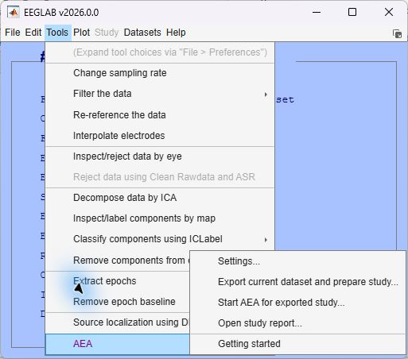
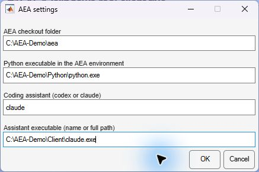
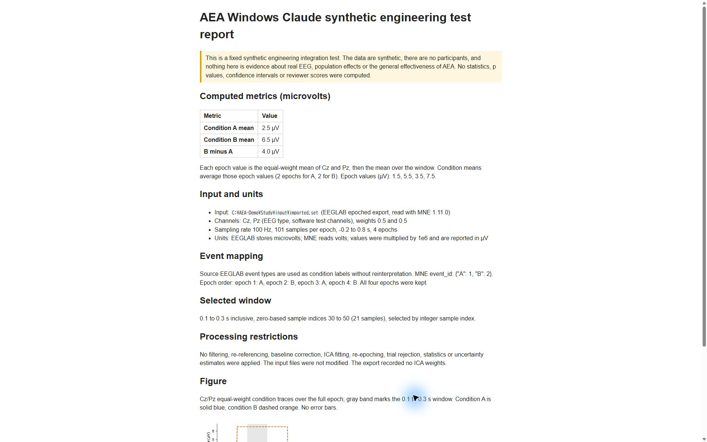

# First report on Windows

This walkthrough covers the MNE-based route. For the 0.1.3 preview
route using native MATLAB/EEGLAB without Python, and the DeepSeek connection
through Claude Code, see [MATLAB setup](MATLAB_NATIVE.md).

Use this walkthrough for **Windows MATLAB/EEGLAB → AEA → a coding client → an HTML report**.
MATLAB supplies the menu and dataset; Python/MNE performs the import checks and
most analysis. Codex CLI and Claude Code are separate client choices. Both routes
have completed the fixed four-epoch synthetic Windows integration test, including
independent result checks, replay and opening the generated report from EEGLAB.
This does not establish real EEG analysis reliability or unattended first-time setup.

## 1. Prepare the analysis environment

Install [Git for Windows](https://git-scm.com/downloads/win) and
[Miniconda](https://www.anaconda.com/docs/getting-started/miniconda/install).
Open **Miniconda PowerShell Prompt**, then run:

```powershell
git clone https://github.com/dengzhe-hou/auto-eeg-analysis.git
cd auto-eeg-analysis
conda env create -f environment.yml
conda activate aeais
python -c "import sys, mne; print(sys.executable); print(mne.__version__)"
```

Keep the printed Python path. Reopen this prompt and activate `aeais` for later sessions.

## 2. Install and sign in to one client

Reuse a working installation. Otherwise, choose **one** official installer in PowerShell.

[Codex CLI](https://learn.chatgpt.com/docs/cli):

```powershell
powershell -ExecutionPolicy ByPass -c "irm https://chatgpt.com/codex/install.ps1 | iex"
```

[Claude Code](https://code.claude.com/docs/en/setup):

```powershell
irm https://claude.ai/install.ps1 | iex
```

After installation, open a new prompt, return to the AEA folder and activate
`aeais`. Run `codex --version` then `codex`, or `claude --version` then `claude`,
and follow the client's login prompts. Retain your chosen model and permissions.
An account or API connection is separate from the Python environment.

On Claude Code's first launch, select a terminal text style (for example, **Dark mode**)
and complete sign-in before returning to EEGLAB. Check the CLI login separately,
even if you already use the Claude Desktop app:

```powershell
claude auth status
```

Continue when it reports `"loggedIn": true`. A terminal waiting at the initial
style or sign-in screen has not started the study analysis.

## 3. Connect the skills

From the AEA folder, run the command matching your client:

```powershell
python tools/install_skills.py --agent codex
```

or:

```powershell
python tools/install_skills.py --agent claude
```

Windows uses directory junctions; Developer Mode is not required.

## 4. Fill in the EEGLAB settings

Update an existing checkout with `git pull --ff-only` first. Copy its
`extensions/eeglab/aea` folder into your EEGLAB `plugins` folder, or extract the
matching preview ZIP there. Remove any previous AEA plugin copy and restart
EEGLAB. Both the MATLAB adapter and the checkout's Python bridge are needed;
see [preview versions and validation](EEGLAB.md#what-is-checked).

Run these in the activated PowerShell prompt to find the settings:

```powershell
(Get-Location).Path
python -c "import sys; print(sys.executable)"
where.exe codex
```

For Claude, replace the last command with `where.exe claude`.

Open **Tools → AEA → Settings**:



| Field | What to paste |
| --- | --- |
| AEA checkout folder | The first command's folder, containing `AGENT_GUIDE.md` |
| Python executable | The full `python.exe` path, not the Conda folder |
| Coding assistant | `codex` or `claude` |
| Assistant executable | The working client's `.exe` or `.cmd` path |
| Analysis backend | `mne` for this walkthrough |



The screenshot uses neutral demonstration paths. Paste the paths from your own
setup commands, including your own Python and client executable locations.
It shows the earlier four-field dialog; version 0.1.3 adds the backend field.

## 5. Export, plan and run

1. Load your dataset in EEGLAB. Continuous data and at least two epochs are supported.
2. Choose **Export current dataset and prepare study**, select a new folder and choose `custom` or a matching recipe.
3. Choose **Start AEA for exported study**. In the opened client, explain your study and missing choices, for example:

```text
Inspect the exported dataset and its processing history. Help me specify the
study question, event meanings, channels, measurements and statistics in an
analysis plan. Ask about missing choices and wait for my approval before their
dependent computations. Keep previously approved choices.
```

Approve the completed plan, then request execution. Terminal permission prompts
remain governed by the client's existing settings.

## 6. Open the result

After the client creates `report-stage/report.html`, choose **Open study report**
and select that study folder. Inspect the saved plan, code, results and checks.
The original EEGLAB dataset is retained; generated analysis is not automatically
loaded back into `EEG`.



This example is the four-epoch synthetic integration test: its known means are
2.5 µV and 6.5 µV, with B−A equal to 4 µV. The screenshot comes from the completed
Windows Claude test, after initial login and terminal setup. It illustrates the
report location and display; it is not a real-participant EEG result.

The default full-workflow audit needs a
[separately configured reviewer](GETTING_STARTED.md#configure-the-reviewer),
including when Claude runs the analysis. Other file-aware agents have a
[manual entry point](GETTING_STARTED.md#use-another-file-aware-agent); the plugin's
client selector currently accepts only Codex and Claude.

For startup errors, see [Windows client troubleshooting](EEGLAB.md#windows-client-startup).
